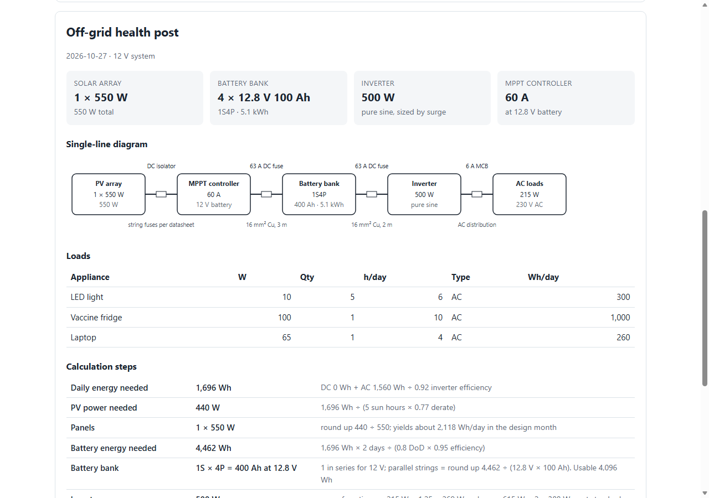

# Off-grid Solar Sizing Calculator

**Live demo:** https://kesuj.github.io/solar-sizing-tool/ · [Sample PDF report](docs/sample-report.pdf)

This is a browser tool for sizing a first-pass off-grid solar PV and battery system. You list the loads, check the site and equipment assumptions, and it returns:

- the number of solar panels
- the battery bank (series and parallel layout)
- the inverter rating, checked against both continuous load and motor start-up surge
- the MPPT charge controller rating
- DC fuse and AC breaker ratings
- copper cable sizes, checked against both voltage drop and fuse rating
- a single-line diagram and a printable PDF report that shows every calculation step



**This is a preliminary design aid, not a stamped engineering design.** Results must be checked against local electrical codes, manufacturer datasheets and site conditions by a qualified person.

## Why I built it

Off-grid sizing jobs (clinics, cold rooms, farms, shops) tend to have the same failure points:

- Fridge and pump start-up surge trips an undersized inverter.
- The battery bank is sized without depth of discharge or days of autonomy.
- Battery cables are sized for voltage drop but not to carry the fuse rating.

This tool makes each of those checks explicit and shows the arithmetic, so a client or reviewer can audit it line by line.

## Method

| Step | Formula |
|---|---|
| Daily energy | Σ DC Wh + Σ AC Wh ÷ inverter efficiency |
| System voltage (auto) | 12 V up to 800 W / 2 kWh per day, 24 V up to 2.5 kW / 5 kWh, otherwise 48 V |
| PV array | daily Wh ÷ (worst-month peak sun hours × derate), rounded up to whole panels |
| Battery | daily Wh × autonomy days ÷ (depth of discharge × round-trip efficiency); series count = system V ÷ unit V, parallel strings rounded up |
| Inverter | next standard size ≥ max(continuous AC load × 1.25, surge load ÷ 2) |
| MPPT controller | array W ÷ battery V × 1.25, next standard size |
| Fuse | next standard size ≥ 1.25 × design current |
| Cable | smallest copper size with voltage drop ≤ limit (2-wire DC run) **and** ampacity ≥ fuse rating |
| AC breaker | inverter W ÷ AC voltage × 1.25, next standard MCB |

Ampacities are indicative values for single-core PVC cable at about 30 °C in free air (see `CABLE_TABLE` in `src/engine.js`). Derate them for conduit, heat and bundling.

## Run it

It has no dependencies or build step. ES modules need a local server:

```bash
py -m http.server 8766        # or: npx serve .
# open http://localhost:8766/
```

## Tests

```bash
npm test          # 10 unit tests; expected values were worked out by hand first
npm run test:ui   # 8 browser checks in headless Edge (serve the folder first); writes docs/ screenshots and a sample PDF
```

The unit tests in `test/engine.test.js` cover:

- the worked clinic example: 1,696 Wh/day, 1 × 550 W panel, 1S4P LiFePO4 bank, a 500 W inverter (surge-limited), a 60 A MPPT controller, and cables upsized from 10 mm² to 16 mm² because of the 63 A fuse
- automatic system-voltage selection
- the fuse-and-ampacity rule
- the lead-acid versus LiFePO4 comparison
- invalid input
- warnings
- DC-only systems

The browser test covers:

- the results the page displays
- switching battery chemistry
- adding a load
- the shareable-link round trip
- input validation
- the mobile layout
- PDF output

### Python version

`python/solar_sizing.py` is a dependency-free Python port of the same engine with a CLI. It reads a `loads.csv` and prints the sizing summary or JSON.

`python/test_solar_sizing.py` holds the PyTest suite:

- it reuses the same hand-calculated checks as the JavaScript tests
- it adds a **cross-implementation test** that runs the JavaScript engine on 40 random load sets and requires every result to match the Python one
- CI (`.github/workflows/test.yml`) runs both test suites on every push

```bash
cd python
python -m pytest -q                      # 14 tests
python solar_sizing.py loads.csv --psh 4.5 --autonomy 2 --chem lfp
```

## Files

- `src/engine.js`: pure sizing functions, testable without a browser
- `src/app.js`: the user interface (load table, presets, report, diagram, CSV export, shareable link)
- `docs/`: screenshots and `sample-report.pdf`

## Limits

- **No PV string design.** It does not check panel Voc against the controller's maximum input voltage at the coldest temperature.
- **No detailed protection coordination.** Fuse and breaker sizes are first estimates.
- **Peak sun hours are an input.** Use worst-month data for the site, for example from PVGIS or NASA POWER.
- **Inverter surge is assumed to be 2× its rating.** Check the actual model's datasheet.
